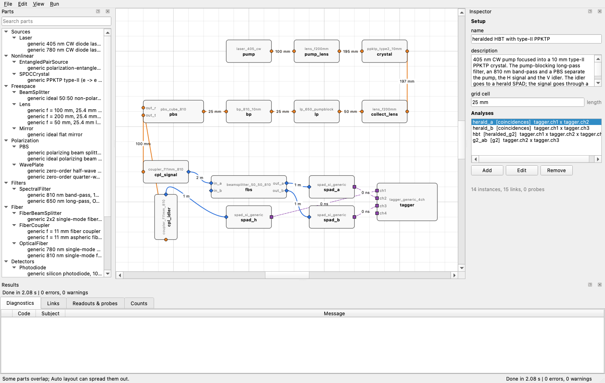

# SEQUOIA

**S**imulated **E**valuation of **QU**antum **O**ptics **I**nstruments and **A**nalysis (pronounced se-KWOY-uh).

A desktop simulator for quantum optics lab setups. Build an experiment from a library of
characterized parts (lasers, SPDC sources, lenses, wave plates, filters, fibers, SPADs/SNSPDs, time
tagger), then read off what the light does at every link and what the detectors will see:
power, polarization, beam size, singles, coincidences, CAR, heralding efficiency, g2, HOM
visibility and CHSH.



One-page overview: [docs/overview.pdf](docs/overview.pdf)

## What it does

- **Schematic editor.** Place parts (drawn with optics-schematic icons) anywhere on a grid, rotate
  and flip them, and connect them with air, fiber (SM, PM or MM, with an adjustable loss that
  defaults to 0 dB) or cable links; links route around other parts. Switch a link between air and
  fiber in the inspector (launch couplers are inserted automatically). Undo/redo, copy/paste,
  auto layout.
- **Classical engine.** Per-wavelength Jones matrices and Gaussian beams (ABCD, M²) with coherent
  combination of paths, so interferometer fringes, coherence length and mode mismatch come out
  naturally. Fiber coupling is computed as a mode overlap.
- **Quantum rate engine.** SPDC pair sources (spdcalc) or entangled-pair black boxes, pushed
  through the same network and into detector, dead-time, jitter and coincidence-window models.
- **Library Manager.** File > Library Manager... (Ctrl+Shift+L): browse, create, duplicate, rename
  and delete parts; forms are generated from each type's schema; import a curve from CSV/XLSX or
  type it into a table; per-value provenance (source, date, who, reference, note); attach
  datasheets. Saved parts appear in the palette at once.
- **Parts as data.** A part is a `part.yaml` plus CSV curves with provenance per value
  (datasheet, measured, model, ideal default). CSV/XLSX import converts %, OD, dB and
  responsivity to SI curves.
- **Results and analysis.** Hover a link for its beam card (power, flux, w_x/w_y, R, waist,
  polarization ellipse, spectrum); link colours follow wavelength. Tabs for beam caustic,
  polarization (ellipse and Poincaré sphere), spectra, g2 / HOM histograms, power and pair-photon
  budgets, and 1D/2D parameter sweeps with CSV/PNG export.
- **Monte Carlo time tags.** Event-level simulation of every detector and tagger channel with
  dead time, jitter tails, afterpulsing and dark counts; the same correlation analysis runs on
  recorded tag files.
- **Gaussian engine.** Exact multimode photon statistics (threshold clicks, photon-number
  distributions, high gain) from the same network transfers.
- **Optimizer and budgets.** Maximize or minimize any result by tuning bounded parameters
  (scipy), and rank which part limits a result by replacing each part with its ideal.
- **Diagnostics.** Pump leakage, aperture clipping, fiber below cutoff, curve extrapolation,
  coincidence peak outside the window, and more; each links back to the offending component.

```
parts (YAML + CSV) ─► setup graph ─► validation ─► classical engine ─► rate engine ─► readouts
```

## Components

| Category | Types |
|---|---|
| Sources | `Laser` (CW / pulsed) |
| Nonlinear | `SPDCCrystal`, `EntangledPairSource` |
| Free-space | `Lens`, `Objective`, `Mirror`, `BeamSplitter`, `DichroicMirror`, `Iris`, `BeamDump` |
| Polarization | `WavePlate`, `Polarizer`, `PBS`, `FiberPaddleController` |
| Filters | `SpectralFilter`, `NDFilter` |
| Fiber | `OpticalFiber`, `FiberCoupler`, `FiberBeamSplitter` |
| Detectors | `SPAD`, `SNSPD`, `Photodiode` |
| Electronics | `TimeTagger` |
| Probes | `PowerMeter`, `BeamProfiler`, `Polarimeter`, `Spectrometer` |

The shipped `library/` has a generic placeholder part for every type (ideal or model values, no
vendor numbers). Replace them with your measured parts before trusting absolute numbers: create a
part in the Library Manager, import the vendor's raw-data CSV/XLSX for its curves, and set the
provenance of each value.

## Example setups

| File | What it shows |
|---|---|
| `setups/laser_fiber_coupling.yaml` | laser, telescope, mirrors, fiber coupler, SMF: coupling efficiency |
| `setups/mzi.yaml` | Mach-Zehnder fringes and coherence-limited visibility |
| `setups/hbt_heralded.yaml` | type-II PPKTP, heralded HBT: singles, CAR, heralded g2 |
| `setups/hom.yaml` | HOM dip versus delay |
| `setups/bell_test.yaml` | polarization correlations and CHSH |

## Project layout

```
src/sequoia/
  units.py data.py        pint boundary parsing, Scalar/Curve/Surface/Provenance
  components/             one module per category; registry of types
  light/                  spectra, Gaussian modes, beam state, pair amplitudes, detection
  engines/                classical.py, rates.py, cache and report helpers
  analysis/               CAR, heralding, visibility, CHSH, tomography (MLE)
  library/                part store and CSV/XLSX importer
  setup/                  setup model, YAML I/O, validation
  gui/                    document, canvas, palette, inspector, results, main window
library/                  part library (data)
setups/                   example setups
docs/                     plan, conventions, M3 report, overview
```

## Status

All milestones of the plan are done (M0 to M8): data model and library, classical engine, quantum
rate engine, the GUI shell with the schematic editor, results plots, sweeps, optimizer and
budgets, the Library Manager, the Monte Carlo time-tag engine and the Gaussian multimode engine
(see [docs/PLAN.md](docs/PLAN.md)). The test suite covers
analytic checks (Malus, HWP rotation, thin lens, Gaussian overlap, MZI visibility, CHSH
S = 2√2·V, HOM against spdcalc, dead time against Monte Carlo).

Deferred to a later iteration: the PDF plot digitizer, AI-assisted datasheet extraction and
characterization wizards.

Known limits:

- The absolute SPDC pair rate is uncertain by a factor of about 0.4 to 2; set a measured
  `brightness` on the part for real experiments (details in [docs/M3_REPORT.md](docs/M3_REPORT.md)).
- Collection modes are taken from part data, not back-propagated through the optics.
- Thin lenses, mode tracked at the central wavelength, no GDD or PMD.
- Feed-forward networks only: no cavities or back-reflections.
- The GUI has been exercised through offscreen tests and rendered screenshots; keyboard
  shortcuts have had little live-display testing.

## Setup

```bash
uv sync --all-extras
```

On macOS, a `.venv` directory inside a synced folder (such as Desktop) can get its files flagged `hidden`.
Python then ignores the editable-install `.pth` file and Qt can't find its plugins. This repo therefore
keeps the environment in `venv/` with `.venv` as a symlink to it. If `uv sync` ever recreates a real
`.venv`, remove it and rerun:

```bash
rm -rf .venv && UV_PROJECT_ENVIRONMENT=venv uv sync --all-extras && ln -s venv .venv
```

## Run

```bash
uv run sequoia
```

Open a setup file in the editor (parts come from `./library`, or from a `library/` folder next to the
file or in one of its parents; override with `--library DIR`, or use File > Open Library...):

```bash
uv run sequoia setups/hbt_heralded.yaml
```

Drag parts from the palette onto the canvas (or double-click them), drag from a port to another
port to link them, and edit values in the inspector. Drag the empty background to pan, Shift+drag
to select several parts, scroll or pinch to zoom (a plain mouse wheel zooms, trackpad scrolling
pans). What each results tab shows is explained in [docs/GUIDE.md](docs/GUIDE.md). The setup is re-simulated in the background
after every edit (Run > Auto-run) and the results dock shows diagnostics, links, readouts and
counts; clicking a diagnostic selects the offending component or link. Shortcuts: `R`/`Shift+R`
rotate, `F` flip, `Delete`, `Ctrl+C`/`Ctrl+V`, `Ctrl+Z`/`Ctrl+Shift+Z`, `Ctrl+L` auto layout,
`Ctrl+G` snap to grid, `Ctrl+=`/`Ctrl+-`/`Ctrl+0` zoom, `Ctrl+Return` run now, `Space`+drag or middle
mouse to pan. Window layout and recent files are remembered between sessions.

Launching `uv run sequoia` without a setup file opens a start screen with New project, Open
project..., the recent projects and a gallery of templates from `templates/` (a laser and power
meter starter, Malus' law, a beam expander, Mach-Zehnder, fiber coupling, an SPDC source with
coincidences and CAR, heralded HBT, Hong-Ou-Mandel and a Bell test). A template opens as a new
untitled project, so saving never overwrites the shipped file. Any YAML setup dropped into
`templates/` (with a `name` and `description`) shows up in the gallery.

Simulate a setup from the command line:

```bash
uv run sequoia run setups/laser_fiber_coupling.yaml
```

The parts come from `library/` (override with `--library DIR`).

## Photon-pair experiments (M3)

Three example setups use the quantum layer (type-II PPKTP SPDC, an entangled-pair black box, SPAD
and SNSPD detectors, a time tagger). The parts in `library/` are generic placeholders; every value
is tagged `ideal-default` or `model` (no vendor numbers), so replace them with measured parts.

```bash
uv run sequoia run setups/hbt_heralded.yaml   # heralded HBT: singles, coincidences, CAR, heralding, g2
uv run sequoia run setups/hom.yaml            # HOM interference; vary the length of link delay_arm
uv run sequoia run setups/bell_test.yaml      # four-outcome polarization correlations, CHSH
```

`sequoia run` prints the classical link table and then a "Photon rates" section: per tagger channel
singles, pair and background counts, coincidence rates for every channel pair, the analyses listed
under `analyses:` in the setup (`coincidences`, `heralded_g2`, `g2`, `histogram`) and rate
diagnostics (`pump_leakage`, `delay_aliasing`, `coincidence_outside_window`, ...). Use `window:`
and `center: auto` (the correlation peak) or an explicit delay that includes cable delays.

Python access:

```python
from sequoia.engines.rates import simulate_rates
from sequoia.analysis import metrics  # car, chsh_s, tomography_settings, mle_density_matrix, ...

result = simulate_rates(setup, library)
result.analyses["herald_a"]["car"], result.channels["tagger.ch1"]["singles_hz"]
```

## Monte Carlo time tags

`sequoia run SETUP --engine mc --duration 10 --seed 1 [--tags out.npz]` simulates time-tag
streams for every tagger channel and analyses them with the setup's `analyses`, side by side with
the rate engine (z-scores in sigma). In the GUI use Run > Monte Carlo time tags... (Monte Carlo
tab). `sequoia analyze-tags FILE --setup SETUP` runs the same analyses on a recorded `.npz` or
`channel,time_s` CSV file.

The pair detection patterns and delay distributions come from the same pair amplitudes as the
rate engine (interference and polarization correlations included); the Monte Carlo then adds
Poisson emission, dark counts, classical leakage, afterpulsing, jitter with exponential tail and
detector and tagger dead times event by event. What to expect:

- At low rates it agrees with the rate engine within statistical errors (tested for HBT, Bell
  and HOM setups).
- The engine's singles are photon detection rates; the Monte Carlo counts clicks, so it is lower
  by the rate of pairs with both photons on one detector (a few percent for a leaky PBS, about
  10% in a HOM dip). The comparison table accounts for this.
- Dead times of different detectors are correlated for coincident pairs; the rate engine treats
  them independently, so coincidences differ by about 0.5% at 50 ns and 600 kHz.
- Pair numbers are Poissonian unless a Schmidt number K is given (GUI: "Pairs per pulse, K";
  CLI: `--schmidt K`): pulsed sources then emit thermal (negative-binomial) pair numbers of K
  equally weighted modes. Thermal bunching of continuous sources on the coherence-time scale is
  not modelled (the rate engine includes it, so heralded g2 differs slightly). A single K is an
  effective description; exact multi-pair statistics are the job of the Gaussian engine.
- Saved tag files (`.npz`, format 2) carry the per-channel pulse clock (0 for CW-only channels),
  the source each clock comes from, and the seed. A channel reached by several sources, or by
  pulsed and CW light, has no single clock and is left out of the map; an empty map is kept as
  such. Coincidences between channels without one common clock (missing, mixed, unequal, or equal
  rates from different sources, which need not be synchronized) use the CW singles product and
  carry `timing` and `timing_note` saying why. Older files and CSV files carry no clock: pass
  `--rep-rate HZ` (pulsed) or `--cw` to `analyze-tags`, otherwise accidentals use the CW singles
  product and a note says so. The coincidence peak is searched
  within +-50 ns, widened to 1 us and 20 us when nothing stands out; set `search`, `center`,
  `center_a`, `center_b` in an analysis entry to override.
- Zero true coincidences and zero accidentals give a CAR of NaN (undefined), not infinity.

## Gaussian multimode statistics

`sequoia run SETUP --engine gaussian [--gain-scale 10]` (or Run > Gaussian multimode statistics...)
computes exact photon-number statistics of the pair sources at the detectors, including the
high-gain regime where multi-pair events matter. The pair amplitude is decomposed into
independent two-mode squeezers (Schmidt modes; for CW sources one small problem per frequency
pair), the rate engine's detector efficiency and path operators act as loss and linear optics,
and threshold-click probabilities, coincidences, heralded g2 and photon-number distributions
(`pnr=`) follow from the Gaussian generating function. `gain_scale` multiplies the pump power:
pair gain and classical (pump) leakage scale with it, detector dark counts do not.

- Statistics are per window: one pulse for pulsed sources, 1/dnu (the lattice period of the
  pair source) for CW sources; coincidences are same-window clicks, so CAR and g2 depend on that
  window. Timing jitter and dead time are not modelled (use the Monte Carlo engine for them).
- At low gain it reproduces the rate engine (singles as photon rates, coincidence rates within
  0.5% for HBT, Bell and HOM); at higher pump power CAR falls as 1/(pairs per window) and the
  heralded g2(0) rises, as expected for thermal multi-pair statistics.
- Photon-number distributions are extracted on an adaptively enlarged contour with an alias
  bound; the result reports the retained probability and the tail above the cutoff, and a
  warning is raised when the contour did not converge.
- All sources must share one time window (the same repetition rate, or the same CW bandwidth);
  otherwise the engine stops with an explicit error instead of reporting inconsistent rates.
- Not supported: sources whose signal and idler leave through one port (exchange
  symmetrisation), and mixed states with more than a few members are computed member by member.
- Needs no extra packages; `thewalrus` (the `gaussian` extra) is only used by the tests as an
  independent check of the covariance formulas.

## CHSH test

`sequoia chsh setups/bell_test.yaml --a settings:hwp_a.angle --b settings:hwp_b.angle
--a-values 0,22.5 --b-values 11.25,33.75 [--time 10]` runs the four analyser settings through the
rate engine, builds E(a, b) from the four coincidence analyses (`tt, tr, rt, rr`) and prints a
**forecast** of S with the anticipated counting spread for `--time` seconds *per setting pair*
(four pairs). The values are those of the analyser parameters (a half-wave plate angle is half the
polarizer angle). The default uses raw coincidences (`--quantity total_hz`); `true_hz` subtracts
accidentals, and the variance of the subtraction (two sideband windows) is included. Raw and
accidental-subtracted S are both printed. The assessment uses |S| (either output labelling) at
three sigma and is undefined when no coincidences are predicted; the duration must be finite and
positive. Coincidences are post-selected on two detections (fair-sampling assumption); a forecast
is not a measured rejection of local models.
From Python: `sequoia.analysis.chsh.run_chsh`. The Monte Carlo comparison marks rows compared with
an analytic model (heralded triples) as `(model)`, since a large z there can be a model difference.
`sequoia.engines.gaussian.detector_response` pushes a Gaussian photon-number distribution through
threshold or pseudo-PNR response models.

## Photon-number circuits (Fock backend)

The results dock has a **Photon counts** tab (Run > Photon counts...) that works on the drawn
setup: it finds the photon inputs itself (`FockSource` parts with N photons per pulse, and SPDC
or entangled-pair sources with thermal pair-number statistics from the pump power), pushes them
through the drawn beam splitters, wave plates, phase shifters, PBS, fibers and filters (path
length contributes `2 pi OPL / lambda`) and reads the setup's own SPAD/SNSPD detectors. It gives
output-state probabilities, expected counts per window and per second (binomial sigma for a
fixed number of windows over a duration), click patterns, marginals, heralded distributions and samples; *Import from setup*
lists the components and inputs, *Extract to circuit editor* turns the drawn circuit into
editable circuit elements. `sequoia fock FILE [--input 1,1,0] [--shots N] [--backend
native|perceval]` runs the circuit engine headless; Perceval GUI circuits (version 2 JSON) import
directly. The native engine needs no extra packages and is cross-checked against Perceval 1.3.1
(extra `perceval`). See [docs/FOCK.md](docs/FOCK.md); `templates/fock_hom.yaml` is a ready example.

## Sweeps, optimization and budgets

In the GUI use the Sweeps tab (Run > Sweep parameter... / Optimize parameters...) or the Budget
tab. From Python:

```python
from sequoia.analysis.sweep import linspace_axis, run_sweep
from sequoia.analysis.optimize import Variable, optimize
from sequoia.analysis.budget import ideal_budget

axis = linspace_axis("settings:hwp_a.angle", 0, 90, 37, "deg")
fringe = run_sweep(setup, library, [axis], ["analysis:tt.true_hz"])

best = optimize(
    setup, library,
    [Variable("link:s2.length", 100, 250, "mm")],
    "link:f1.coupling_efficiency",
)
budget = ideal_budget(setup, library, "analysis:herald_a.true_hz")
```

Parameter targets are `settings:<id>.<name>`, `overrides:<id>.<name>` or `link:<id>.<field>`
(`length`, `delay`, `connector_loss_db`); outputs are flat names such as `link:f1.power_W`,
`readout:pd.photocurrent_A`, `analysis:herald_a.car` (see `sequoia.analysis.sweep.metrics_of`).
The ideal budget replaces one part at a time with an ideal version (unit transmission, unit
detector efficiency, no dark counts); it does not touch collection modes or alignment.

### Units and the meaning of `brightness`

Every physical quantity in a part or setup file is written with its unit (`810 nm`, `10 mW`,
`45 deg`, `25 degC`, `100 cps`, `3.9 pm/V`) and is dimension-checked with a message that names the
field. A bare number is only accepted for dimensionless quantities (extinction ratios, split ratios,
optical density, wave-plate retardance in waves, visibility). In particular a bare `temperature: 25`,
`angle: 45` or `dark_count_rate: 100` is an error with a hint (write `25 degC`, `45 deg`,
`100 Hz`; a bare `0` is accepted for an angle), and `-300 degC` (below absolute zero), `25 mW` for
a temperature or `45 mm` for an angle are rejected. Angles are stored in radians internally and
temperatures in kelvin.

`brightness` (on `SPDCCrystal` and `EntangledPairSource` parts) is the pair rate in pairs/s per
mW of pump power **emitted into the collection modes, before any downstream loss** (filters, fibre
coupling, detector efficiency). It is not a detected coincidence rate: entering a measured
coincidence rate there counts the losses twice. When given it replaces the computed rate of
`SPDCCrystal`; the computed rate carries the uncertainty described in
[docs/M3_REPORT.md](docs/M3_REPORT.md), section 6.

Things to know before trusting a number: [docs/conventions.md](docs/conventions.md) (quantum-layer
approximations) and [docs/M3_REPORT.md](docs/M3_REPORT.md) (physics model, validation, limitations).

## Test

```bash
uv run pytest
```
